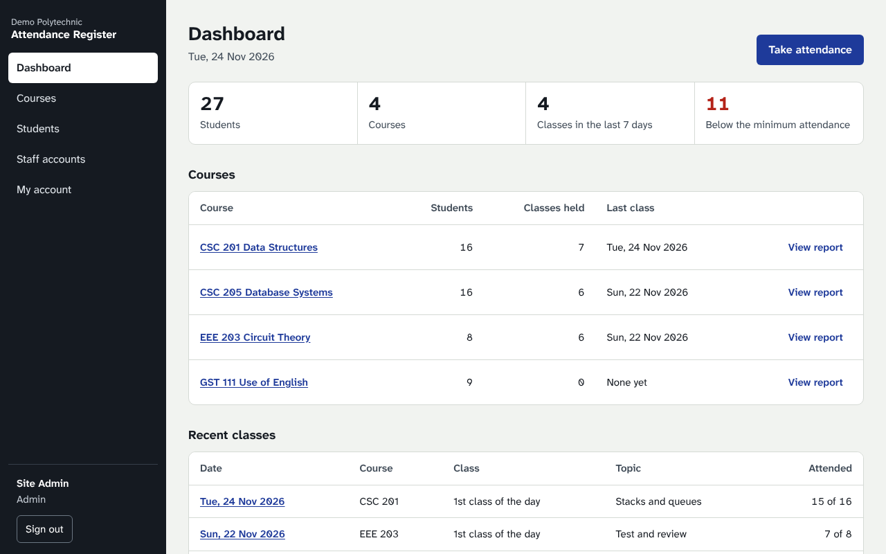
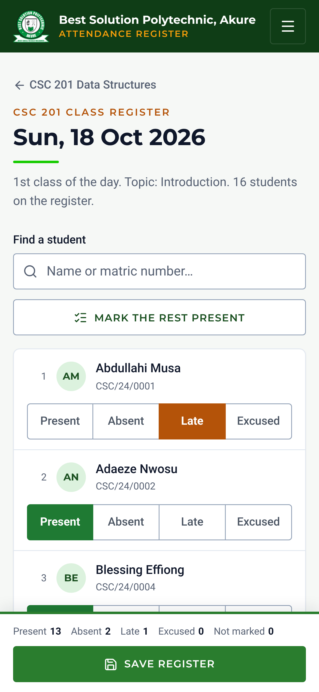

# Attendance Register

A school attendance management system. Lecturers mark the register on a phone or laptop, and the system works out who is below the minimum attendance.

Front end: HTML, CSS and JavaScript (no framework).
Back end: Node.js and Express.
Database: MySQL.

Why is there a back end? A web page cannot talk to MySQL on its own, because that would put the database password inside the browser where anyone can read it. So the browser talks to a small Node.js server, and only the server talks to MySQL.

<p>
  
  
</p>

## What it does

- Sign in with two roles: admin and lecturer.
- Students: add, edit, delete, search, filter, and import a whole class list by pasting it.
- Courses: create a course, assign a lecturer, set the minimum attendance (75% by default).
- Put students in a course one by one, or a whole department and level at once.
- Take attendance: each student is marked Present, Absent, Late or Excused.
- Reports per course with a percentage for every student, a flag on everyone below the minimum, and a CSV download that opens in Excel.
- Staff accounts: add lecturers, reset passwords, deactivate accounts.

| | Admin | Lecturer |
|---|---|---|
| Manage students, courses, staff | Yes | No |
| See courses | All | Only their own |
| Take attendance and view reports | All courses | Only their own |
| Add or remove students in a course | Yes | Only their own |

## What you need

1. **Node.js 20 or newer.** Download the LTS version from https://nodejs.org and install it.
2. **MySQL.** Either MySQL 8, or XAMPP (its "MySQL" is MariaDB, which works too).

Check Node.js is installed. Open a terminal (on Windows: press Start, type `cmd`, press Enter) and run:

```
node -v
```

You should see something like `v22.11.0`. If you see "not recognized", install Node.js and open a new terminal.

## Setup

### Step 1. Start MySQL

- **XAMPP:** open the XAMPP Control Panel and press **Start** next to MySQL. The label turns green.
- **MySQL 8 installed on its own:** it normally starts with your computer.

### Step 2. Open the project folder in a terminal

Download or clone the project. Then in the terminal, move into the folder. Example on Windows if it is on your Desktop:

```
cd Desktop\attendance-system
```

### Step 3. Install the packages

```
npm install
```

This downloads the libraries the server needs into a `node_modules` folder. It takes about a minute. It ends with a line that starts with `added` and a number of packages.

### Step 4. Run setup

```
npm run setup
```

Setup asks a few questions. Press Enter to accept the value shown in [brackets].

- MySQL host, port, username: press Enter for each on a normal XAMPP install.
- MySQL password: press Enter on XAMPP (it has none by default). Type your password if you set one.
- Database name: press Enter to use `attendance_system`.
- School name: type the name you want on the sign-in page.
- Then your name, email and a password. This becomes the first admin account.

Setup creates the database and all tables, writes your settings to a file called `.env`, and creates your admin account. It ends with "Setup finished".

### Step 5. Start the system

```
npm start
```

You should see:

```
Attendance system is running.
Open http://localhost:3000 in your browser.
```

Open that address and sign in with the email and password you chose in step 4. Keep the terminal window open while you use the system. Press Ctrl + C in the terminal to stop it.

### Optional: load demo data

To see every screen filled in before you add real records:

```
npm run seed:demo
```

This adds 24 made-up students, 3 courses, 2 lecturers and six weeks of attendance. It prints the demo lecturer password once, so write it down. It refuses to run if students already exist, so it can never mix into real data.

## First things to do after signing in

1. **Staff accounts**: add your lecturers. Give each one their first password in person.
2. **Students**: press **Import a list** and paste your class list. One student per line: matric number, full name, department, level. You can copy four columns straight from Excel.
3. **Courses**: add a course and pick its lecturer.
4. Open the course, go to **Students**, press **Add a whole class** and pick the department and level.
5. Press **Take attendance**. Mark the register and press **Save register**.

"Level" is free text, so use whatever your school uses: 100 Level, ND 1, SS 2 and so on.

## How the percentage is worked out

- Present and Late both count as attended.
- Excused classes are left out of the total, so an excused absence never lowers the score.
- A class where the student has no mark counts as absent.

Example: 10 classes held, 6 present, 1 late, 1 excused, 2 absent. Attended is 7, counted classes are 9, so attendance is 77.8%.

The rule lives in one file, `src/utils/attendanceMath.js`, so there is one place to change it.

## Using it on phones in class

The marking screen is built for a phone. To let lecturers reach it:

1. Connect the computer running the system and the phones to the same Wi-Fi.
2. Find the computer's IP address. On Windows run `ipconfig` and look for "IPv4 Address", for example `192.168.1.20`.
3. On the phone open `http://192.168.1.20:3000`.

If the phone cannot connect, Windows Firewall is usually blocking it. Allow Node.js through the firewall when Windows asks, or allow port 3000.

## Project layout

```
attendance-system/
  database/schema.sql      All tables. Setup runs this for you.
  scripts/setup.js         One-time setup (npm run setup)
  scripts/seed-demo.js     Optional demo data
  src/
    server.js              Starts the server
    app.js                 Wires everything together, security settings
    config/env.js          Reads the .env settings
    db/                    Database connection and login session storage
    middleware/            Sign-in check, role check, error handling
    routes/                The API addresses (/api/students and so on)
    services/              The real work: every database query lives here
    utils/                 Validation, the attendance formula, CSV
  public/                  Everything the browser loads
    *.html                 One file per page
    css/tokens.css         Colours, sizes, fonts. Change the look here.
    css/base.css           Basic page styles
    css/components.css     Buttons, tables, forms, the register
    js/lib/                Shared code (API calls, dialogs, tables)
    js/pages/              One script per page
  tests/                   Automated tests
```

A request travels like this: page script → `js/lib/api.js` → a file in `routes/` (checks the input and the permission) → a file in `services/` (runs the SQL) → MySQL.

## Common problems

| What you see | Cause | Fix |
|---|---|---|
| `MySQL is not running` | MySQL is stopped | Start it in XAMPP, then run the command again |
| `MySQL refused that username or password` | Wrong details | Run `npm run setup` again and type the right ones |
| `Port 3000 is already in use` | Another program uses the port | Open `.env`, change `PORT=3000` to `PORT=3001`, start again |
| `Missing setting: SESSION_SECRET` | Setup has not been run | Run `npm run setup` |
| `'node' is not recognized` | Node.js is not installed | Install it from nodejs.org and open a new terminal |
| Signed out after a restart of MySQL | Normal | Sign in again |
| Forgot the admin password | No other admin to reset it | See below |

**Forgot the only admin password?** Stop the server, open phpMyAdmin, open the `users` table and delete the admin row. Then run `npm run setup` again. It sees there is no admin and asks you to create one. Students, courses and attendance are not touched.

## Tests

```
npm test
```

Runs 20 quick checks on the validation rules, the attendance formula and the CSV export. No database needed.

```
npm run test:api
```

Runs 26 end-to-end checks through the real API: sign-in, permissions, a lecturer trying to open another lecturer's course, double clicks, bad input, the report numbers, and the one-time setup page. It uses its own databases (your database name with `_test` and `_setup_test` added) and wipes them on every run. Your real data is never touched.

Both sets pass on MySQL 8.0 and on MariaDB 10.11.

## Security built in

- Passwords are stored as bcrypt hashes, never as plain text.
- Every query uses placeholders, so typed text can never be run as SQL.
- Every permission is checked on the server. Hiding a button is never the only guard.
- Text from the database is always put on the page as text, never as HTML.
- Sign-in is limited to 20 failed attempts per 15 minutes per network address.
- The login cookie cannot be read by scripts and is not sent by other websites.
- Changing or resetting a password signs that person out on their other devices.
- CSV downloads are protected against spreadsheet formula injection.

## Deploying online (Railway)

The app runs on any host that gives you Node.js and MySQL. On a host there is no terminal for `npm run setup`, so the server sets itself up on every start: it creates missing tables and generates its own session secret.

1. Create a project on Railway with a **MySQL** database and a service from this GitHub repo.
2. In the app service, set these variables. None of them are passwords:

| Variable | Value |
|---|---|
| `DATABASE_URL` | `${{MySQL.MYSQL_URL}}` (Railway fills it in) |
| `NODE_ENV` | `production` |
| `SCHOOL_NAME` | the school name shown on every page |
| `SCHOOL_MOTTO` | optional, shown on the sign-in page |
| `PROJECT_NOTE` | optional, a line shown on every page |

3. Under Settings, Networking, press **Generate Domain**.
4. Open the app's **Deploy Logs** and copy the line `Setup code: XXXX-XXXX`.
5. Open the site. It shows **Set up this system**. Enter the setup code, then your name, email and password. Tick the box to add the demo data.

The setup page works once. After the first admin exists it sends everyone to sign in. Only someone who can read the server log has the code, so a stranger who finds the link first cannot claim the system.

If you would rather not use the setup page, set `ADMIN_NAME`, `ADMIN_EMAIL` and `ADMIN_PASSWORD` instead, and optionally `SESSION_SECRET`, `DEMO_DATA=true` and `DEMO_PASSWORD`.

## Before putting it on the internet

On your own computer or a classroom network the defaults are fine. On a public server, do these first:

1. Set `NODE_ENV=production` in `.env`. This turns on secure cookies and strict HTTPS headers.
2. Serve it over HTTPS (for example behind Nginx or Caddy with a free certificate). With `NODE_ENV=production` sign-in only works over HTTPS.
3. Create a MySQL user just for this app with a strong password. Do not use `root`.
4. Back up the database on a schedule. In phpMyAdmin use Export, or run `mysqldump attendance_system > backup.sql`.
5. Run the server with a process manager such as PM2 so it restarts after a crash or reboot.

## What is and is not included

Implemented and tested: everything listed under "What it does".

Not included: students signing in to see their own attendance, QR code or fingerprint check-in, email or SMS alerts, timetables, and semester archiving. The data model has room for each of them.

Checked in a desktop browser at phone, tablet and desktop sizes. Not yet checked on a physical phone or on Windows with XAMPP 10.4, so do one run through setup and the marking screen on your own machine before a demo.

## Look and fonts

The colours are set up for Best Solution Polytechnic, Akure (green `#2a7d2e`, as on bestpotech.edu.ng). To use another school's colours, change the brand block at the top of `public/css/tokens.css`. Everything else follows from it.

Headings use Montserrat. Body text uses Atkinson Hyperlegible Next, made by the Braille Institute, which keeps look-alike characters such as 0 and O, or 1 and l, easy to tell apart when reading matric numbers. Both are bundled in `public/fonts` under the SIL Open Font License, so the system works with no internet connection.
